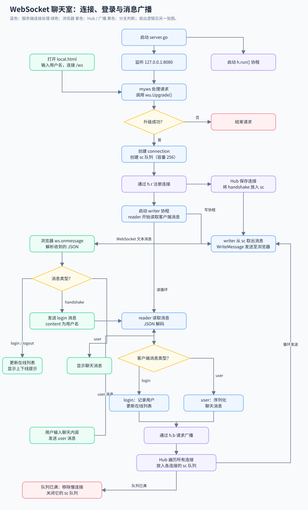
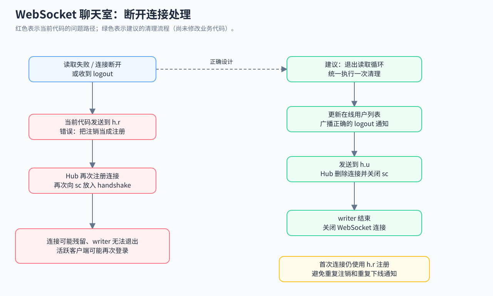
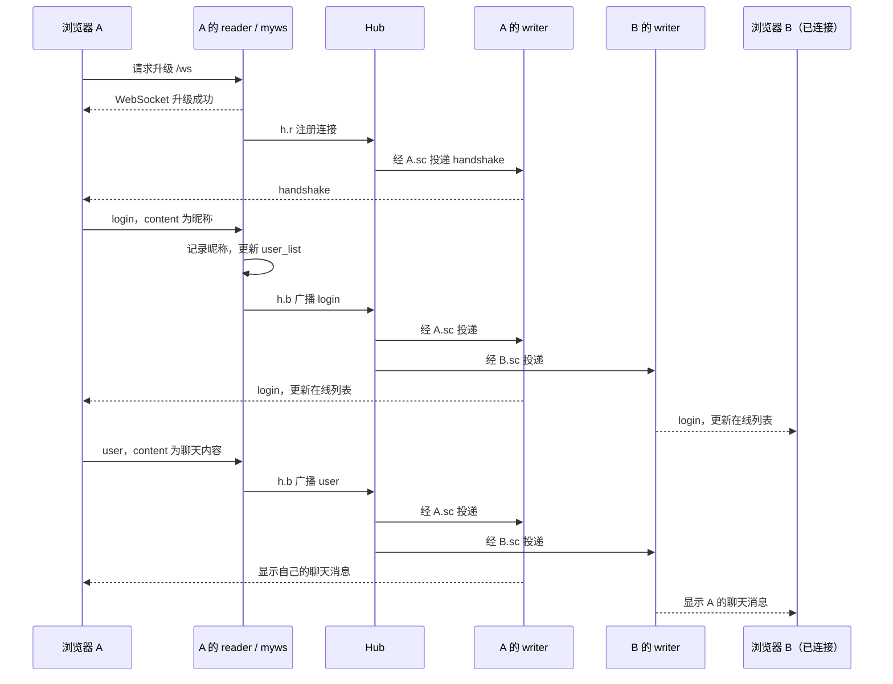
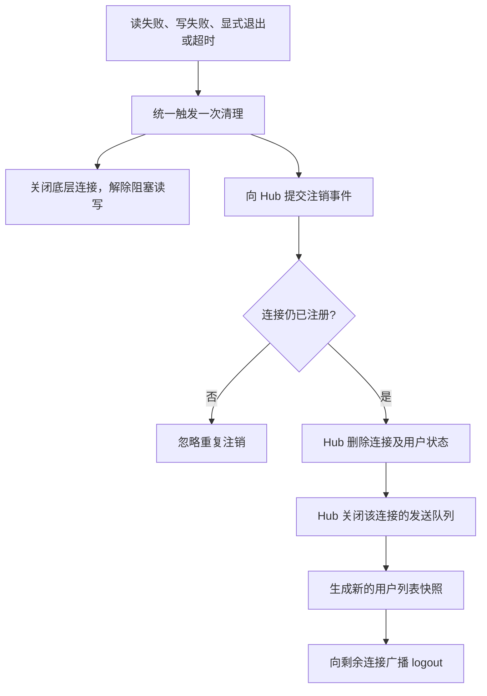

# WebSocket 聊天室代码分析

> 本文基于当前目录源码进行静态分析，未执行编译或浏览器联调。文中明确区分现有行为与改进建议，不代表问题已经修复。

## 1. 项目概览

这是一个使用 **Go + Gorilla WebSocket + 原生 JavaScript** 实现的简易多人聊天室，主要功能包括：

- 浏览器与服务端建立 WebSocket 长连接。
- 用户输入昵称后加入聊天室。
- 服务端向所有连接广播聊天消息。
- 前端展示在线用户、聊天内容和上下线通知。

整体采用 **Hub 集中管理连接，每个连接分别读写消息** 的结构。

```text
web_socket/
├── server.go          # 程序入口、HTTP 路由和监听
├── connection.go      # WebSocket 升级、单连接读写、登录和退出处理
├── hub.go             # 连接注册、注销和消息广播
├── data.go            # JSON 消息结构
├── local.html         # 聊天室页面和浏览器端逻辑
├── README.md          # 本文
└── docs/
    ├── websocket-flow.svg
    └── websocket-disconnect.svg
```

## 2. 整体流程图

### 2.1 连接、登录与广播



### 2.2 断开连接：现状与建议

红色路径表示当前代码中的问题，绿色路径表示建议的清理方式。



这两张图使用 Markdown 图片语法引用，不依赖 Mermaid 插件；需要保留 `docs/` 目录与本文的相对位置。

## 3. 核心数据结构

### 3.1 `Data`：前后端消息协议

文件：[`data.go`](data.go)

```go
type Data struct {
    Ip       string   `json:"ip"`
    User     string   `json:"user"`
    From     string   `json:"from"`
    Type     string   `json:"type"`
    Content  string   `json:"content"`
    UserList []string `json:"user_list"`
}
```

| JSON 字段 | 含义 | 当前用途 |
| --- | --- | --- |
| `ip` | 客户端网络地址 | Hub 注册时写入，实际通常包含端口 |
| `user` | 当前连接关联的用户名 | 登录时由 `content` 赋值 |
| `from` | 消息发送者 | 登录时设置，前端用来展示发送者 |
| `type` | 消息类型 | 区分握手、登录、聊天和退出 |
| `content` | 消息内容 | 登录时为昵称，聊天时为正文 |
| `user_list` | 在线用户名列表 | 前端刷新在线列表和人数 |

主要消息类型：

| 类型 | 方向 | 用途 |
| --- | --- | --- |
| `handshake` | 服务端 → 新连接 | 提示浏览器发送登录消息 |
| `login` | 浏览器 → 服务端 → 所有连接 | 注册昵称并通知上线 |
| `user` | 浏览器 → 服务端 → 所有连接 | 广播聊天内容 |
| `logout` | 服务端 → 所有连接；后端也接受客户端发送 | 通知下线，当前实现存在问题 |
| `system` | 前端支持接收 | 当前后端没有对应的主动发送逻辑 |

注意：这里的 `handshake` 是应用层 JSON 消息，不是 HTTP 升级时的 WebSocket 协议握手。

### 3.2 `connection`：单个客户端连接

文件：[`connection.go`](connection.go)

```go
type connection struct {
    ws   *websocket.Conn
    sc   chan []byte
    data *Data
}
```

- `ws`：真实的 WebSocket 连接。
- `sc`：该连接的待发送消息队列，容量为 **256 条消息**。
- `data`：被持续复用的消息对象，同时存放用户相关信息。

`sc` 的缓冲可以减少慢客户端对广播的影响，但不是无限队列，也不是按字节数限制内存。

### 3.3 `hub`：连接管理中心

文件：[`hub.go`](hub.go)

```go
type hub struct {
    c map[*connection]bool
    b chan []byte
    r chan *connection
    u chan *connection
}
```

| 字段 | 含义 | 处理方式 |
| --- | --- | --- |
| `c` | 已注册连接集合 | 使用 map 的键保存连接 |
| `r` | register，注册通道 | 保存连接并发送 `handshake` |
| `u` | unregister，注销通道 | 删除连接并关闭其 `sc` |
| `b` | broadcast，广播通道 | 将消息放入各连接的 `sc` |

`r`、`u`、`b` 都是无缓冲通道，发送方需要等待 Hub 接收。`c` 只在 `h.run()` 中操作，因此连接 map 本身不需要额外加锁；这并不意味着其他共享数据也安全。

## 4. 按执行顺序分析后端

### 4.1 启动服务：`main()`

文件：[`server.go`](server.go)

```go
router := mux.NewRouter()
go h.run()
router.HandleFunc("/ws", myws)
http.ListenAndServe("127.0.0.1:8080", router)
```

执行过程：

1. 创建 HTTP 路由器。
2. 启动 Hub 协程，持续接收通道事件。
3. 将 `/ws` 路由交给 `myws()` 处理。
4. 监听本机 `8080` 端口。

**注意：** 服务只监听回环地址，不能直接被其他机器访问；这里只注册了 `/ws`，没有提供 `local.html` 的静态文件路由。

### 4.2 升级并注册连接：`myws()`

核心代码：

```go
ws, err := wu.Upgrade(w, r, nil)
if err != nil {
    return
}
c := &connection{sc: make(chan []byte, 256), ws: ws, data: &Data{}}
h.r <- c
go c.writer()
c.reader()
```

执行过程：

1. `Upgrade()` 将 HTTP 请求升级为 WebSocket 连接。
2. 创建连接对象及独立发送队列。
3. 向 `h.r` 发送连接，通知 Hub 注册。
4. 启动独立的 `writer()` 协程。
5. 在当前 HTTP 请求处理协程中运行 `reader()`。

因此，不是整个服务只能处理一个客户端：`net/http` 会并发处理请求，每个连接有自己的读循环和写协程。

`ReadBufferSize` 和 `WriteBufferSize` 都设置为 512，它们是读写缓冲区配置，**不等于单条消息最大只能有 512 字节**。

### 4.3 注册事件：Hub 发送应用层握手

`h.run()` 收到 `h.r` 中的连接后：

1. 执行 `h.c[c] = true`，保存连接。
2. 记录客户端网络地址。
3. 设置消息类型为 `handshake`。
4. 附带当前在线用户名列表。
5. 将 JSON 放入这个连接的 `sc`。

握手消息只发送给新连接，不向全部客户端广播。

### 4.4 读取消息：`reader()`

读循环持续执行：

```go
_, message, err := c.ws.ReadMessage()
```

随后解码 JSON，根据 `c.data.Type` 分支处理。

#### `login`：登录

```go
c.data.User = c.data.Content
c.data.From = c.data.User
user_list = append(user_list, c.data.User)
c.data.UserList = user_list
```

服务端把昵称记录在连接对象中，追加在线列表，然后通过 `h.b` 广播登录信息。所有收到该消息的页面都会更新在线列表并显示上线提示。

当前没有检查重复登录、重名、空昵称或昵称长度，也没有身份认证；这里的“登录”只是登记昵称。

#### `user`：聊天

服务端把 `c.data` 序列化后交给 `h.b`，不做单独的接收者筛选，因此发送者自己也会收到广播。

浏览器实际只发送：

```json
{"type":"user","content":"大家好"}
```

之所以通常还能显示发送者，是因为服务端反复把 JSON 解码进同一个 `c.data` 对象：新 JSON 没有的字段会保留原值，登录时设置的 `From` 因而被沿用。

这是一种隐式状态依赖，不是可靠的身份校验。客户端如果主动发送 `from` 或 `user`，这些字段也可能被覆盖。

#### `logout`：显式退出

当前分支会删除用户名、广播退出消息，然后执行 `h.r <- c`。

这里存在三个明显问题：

- `h.r` 是注册通道，不是注销通道。
- 没有退出读取循环。
- 没有在此分支重新设置 `UserList` 和退出通知的 `Content`，广播数据可能过期或不正确。

当前页面没有主动发送 `logout` 的代码，关闭页面通常通过 `ReadMessage()` 返回错误进入断线处理。

### 4.5 广播事件：Hub 分发消息

```go
for c := range h.c {
    select {
    case c.sc <- data:
    default:
        delete(h.c, c)
        close(c.sc)
    }
}
```

- 如果连接的发送队列还有空间，就把消息放入队列。
- 如果队列已满，就从 Hub 删除该连接并关闭其发送队列。

这里的 `default` 实现了非阻塞投递，避免 Hub 因一个队列已满的客户端而停住。不过，队列被关闭后，底层网络连接不一定立即关闭，还取决于写协程能否结束。

### 4.6 写出消息：`writer()`

```go
for message := range c.sc {
    c.ws.WriteMessage(websocket.TextMessage, message)
}
c.ws.Close()
```

写协程从 `sc` 取出消息，发送为 WebSocket 文本消息。

当 `sc` 被关闭后，`range` 会先读取剩余缓冲消息，再退出循环并关闭连接。当前忽略写入错误，也没有写超时，因此不能保证及时结束。

读写分离使每个连接通常只有一个读者和一个普通消息写者，符合 Gorilla WebSocket 的常见并发使用方式；但共享业务字段仍需要单独保护。

## 5. 前端逻辑

文件：[`local.html`](local.html)

| 函数或事件 | 作用 |
| --- | --- |
| `prompt()` | 获取用户昵称 |
| `new WebSocket(...)` | 连接本机 `/ws` |
| `ws.onopen` | 显示连接成功提示 |
| `ws.onmessage` | 解析 JSON，并按消息类型处理 |
| `send()` | 读取输入框，发送 `user` 消息 |
| `sendMsg()` | JSON 序列化后调用 `ws.send()` |
| `dealUser()` | 重建在线用户列表，展示上下线提示 |
| `listMsg()` | 追加聊天内容并滚动到底部 |
| `ws.onerror` | 显示错误提示 |

特别注意：前端不是在 `onopen` 中立即发送登录信息，而是在收到服务端的 `handshake` 后才发送 `login`。

当前未实现 `onclose` 处理、自动重连和发送前的 `readyState` 检查。

## 6. 通信时序图

下面是正常连接、登录、聊天路径，不包含当前有缺陷的退出处理。需要支持 Mermaid 的 Markdown 预览器才能渲染。



图中 Hub 到 writer 的箭头表示通过缓冲队列投递，不是 Hub 直接调用 writer。

## 7. 当前代码的关键问题

### 7.1 退出时错误使用注册通道

`connection.go` 中以下三处退出相关位置使用了 `h.r <- c`：

- `ReadMessage()` 返回错误时。
- 收到 `logout` 消息时。
- `myws()` 的延迟清理函数中。

但 `hub.go` 中，真正的注销逻辑位于 `h.u` 分支；当前代码没有向这个通道发送连接。

可能后果：

- 断开的连接仍留在 Hub 中。
- 再次发送 `handshake`，仍活跃的页面收到后可能重新登录。
- `sc` 未关闭，写协程可能一直等待消息。
- 如果连接此前因队列满被移除并关闭 `sc`，重新注册后向已关闭通道发送握手可能引发 panic。

**建议：** 保留首次注册的 `h.r <- c`；读失败、显式退出和写失败统一触发一次注销。不要仅机械替换三处通道名称，还要解决重复清理和退出循环的问题。

### 7.2 `defer` 注册得太晚

当前顺序是：

```go
c.reader()
defer func() {
    // 清理逻辑
}()
```

只有 `reader()` 返回后，才会执行到 `defer` 的注册位置；随后 `myws()` 返回时，这个延迟函数仍会执行。因此不能简单理解成“这个 defer 完全不会执行”。

问题是：如果 `reader()` 在返回前发生 panic，这个清理函数尚未注册，无法提供相应保护。

建议在资源建立后尽早注册清理，并让退出流程幂等。

### 7.3 共享数据存在并发竞争

- 不同连接的 `reader()` 会同时追加、删除全局 `user_list`。
- Hub 也会读取 `user_list`。
- Hub 和连接处理协程都会读写同一个 `c.data`。
- `UserList` 直接引用切片，可能与其他操作共享底层数组。

这些操作没有统一串行化或加锁，可能造成数据竞争、列表错乱和不一致的消息。

**建议：** 将在线用户状态及登录、注销事件统一交给 Hub 管理；需要广播用户列表时创建快照。连接身份与每次收到的消息应拆分，不再共享复用一个 `Data` 对象。

### 7.4 `del()` 删除函数存在逻辑错误

原函数中：

```go
if slice[i] == user && i == count {
```

`range` 产生的下标最大为 `count - 1`，因此 `i == count` 永远不成立。

另外，如果列表非空但找不到用户名，函数最后返回的是新建的空切片，而不是原列表。例如：

```text
del(["Alice", "Bob"], "Nobody")
预期：["Alice", "Bob"]
当前：[]
```

函数目前也只删除第一个匹配项，无法消除重复登录造成的重复记录。

建议明确用户名是否允许重复，并修正“未找到时保留原列表”的逻辑；仅修复这个函数不能解决并发问题。

### 7.5 消息解析与身份校验不足

当前忽略 `json.Unmarshal()` 的错误，畸形 JSON 可能使程序继续使用旧数据或部分更新的数据。JSON `null` 解码到 `&c.data` 还可能将该指针设为 `nil`，导致后续字段访问 panic。

建议：

1. 每条消息解码到独立的局部结构体。
2. 检查 JSON 错误、消息类型和内容长度。
3. 服务端根据连接状态设置发送者，不信任客户端提供的身份字段。
4. 限制重复登录、空昵称及未登录发送消息。

### 7.6 前端存在 HTML 注入 / XSS 风险

页面将聊天内容和用户名赋给 `innerHTML`：

```javascript
msg.innerHTML = data;
user.innerHTML = name_list[index];
```

用户输入会被浏览器当成 HTML 解析，而不是纯文本。应改用 `textContent` 等安全的文本渲染方式。

### 7.7 缺少连接保护和完整错误处理

- `CheckOrigin` 始终返回 `true`，没有限制网页来源；生产环境应设置允许的 Origin。
- 忽略 `WriteMessage()` 错误，无法及时清理失效连接。
- 未调用 `SetReadLimit()`，没有消息大小上限。
- 没有应用主动心跳、Pong 超时检测以及读写截止时间。
- 使用 `ws://`，部署到 HTTPS 页面时通常需要 `wss://`。

这些配置适合用于理解原理，不宜原样暴露为生产服务。

## 8. 推荐的改进结构

以下是改进方案，不是当前代码行为：



职责划分建议：

- **reader**：读取并校验客户端消息，提交业务事件。
- **Hub**：独占维护连接集合、在线用户状态和广播逻辑。
- **writer**：写出消息，处理写错误和写超时。
- **统一清理入口**：确保退出只处理一次，由 Hub 负责关闭发送队列。
- **前端**：安全展示文本，处理断线状态并限制无效发送。

如果所有消息入队和发送队列关闭都由 Hub 执行，可以更容易避免“关闭通道后仍发送”的问题。

## 9. 本地运行与验证建议

### 9.1 启动

在当前 `web_socket` 目录执行：

```bash
go run .
```

然后用浏览器打开 `local.html`，再打开第二个页面模拟另一位用户。

注意：

- 不要只执行 `go run server.go`，否则同目录其他 Go 文件不会作为文件列表的一部分参与编译。
- 项目使用上级目录的 `../../go.mod`，其当前声明为 `go 1.27.1`；运行前需确认该版本声明与可用 Go 工具链兼容。
- 后端没有托管 HTML，访问 `http://127.0.0.1:8080/` 不会直接得到聊天页面。
- 页面里的 `127.0.0.1` 指浏览器所在机器，本示例默认前后端在同一台机器运行。

### 9.2 验证场景

| 场景 | 验证重点 |
| --- | --- |
| 打开两个页面 | 双方是否收到登录通知和用户列表 |
| A 发送消息 | A、B 是否各显示一次，发送者是否正确 |
| 关闭 A 页面 | B 是否更新在线列表，服务端是否清理 A |
| 重复发送 `login` | 是否出现重复用户 |
| 删除不存在的用户名 | 是否错误清空列表 |
| 发送无效 JSON | 是否能拒绝消息而不是复用旧状态或 panic |
| 慢客户端或网络断开 | 是否能及时结束读写并回收连接 |
| 同时登录和退出 | 是否存在共享状态竞争 |

可在支持竞态检测的环境中执行：

```bash
go run -race .
```

再用多个页面并发操作，观察竞态检测报告。竞态检测只能发现实际执行到的竞争路径，未报告并不等于完全没有问题。

## 10. 总结

这份代码最值得学习的是以下消息链路：

**浏览器发送 → reader 接收 → Hub 广播 → 各连接 sc 队列 → writer 写出 → 浏览器渲染。**

Hub 将连接管理与消息发送解耦，读写协程让单连接可以同时收发。但当前退出流程、共享状态、输入校验和前端文本渲染还不完善，应优先修复后再用于更复杂的场景。
